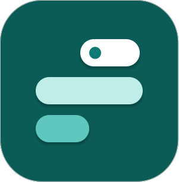

# Sentinel

**Local PHP, Node and databases for all your projects, on Windows.**

Every project at its own address (`https://shop.offline`), each with its own PHP version,
all at the same time, with nothing to download or configure by hand.

[Download](https://github.com/josevictoremiliano/sentinel/releases/latest) ·
[Documentation (Portuguese)](docs/README.md) ·
[Security](SECURITY.md) ·
[Português](README.md)

---

## What it is

Sentinel is a lightweight, native-looking Windows 11 tray app that sets up local development for
**PHP, Laravel and Node** projects, in the spirit of Laravel Herd and Laragon:

- **Several PHP versions at once.** Project A on 8.3, project B on 8.5, side by side. Official builds
  are downloaded, their SHA-256 is checked, and updates are announced.
- **One address per project.** `http://shop.offline` (or `https://` with a local certificate),
  without Apache or Nginx: a gateway written in Rust routes each domain to PHP (FastCGI) or to the
  project's Node dev server.
- **On-demand services.** MariaDB, PostgreSQL, Mailpit (local inbox), S3 storage (RustFS) and
  Adminer. They stay off until a project needs them.
- **Safe `.env` edits.** Sentinel shows what will change, keeps a backup and lets you undo.
- **The right CLI.** `php` and `composer` use the project's version of the current folder, in any
  terminal.
- **Daily tools.** Laravel log viewer with a tidy stack trace, one-click Xdebug, workers (queue,
  scheduler, Reverb) and a new-Laravel-project wizard.
- **Light.** Around 10 MB of memory while in the tray.

The interface is available in Portuguese and English.

## Install

1. Download `Sentinel_x.y.z_x64-setup.exe` from the [releases page](https://github.com/josevictoremiliano/sentinel/releases/latest).
2. Check the download: compare its SHA-256 with `SHA256SUMS.txt` or run
   `gh attestation verify <file> --repo josevictoremiliano/sentinel`.
3. Run the installer (per-user, no admin rights needed).

The installer is not code-signed yet, so Windows SmartScreen may warn you
(*More info › Run anyway*).

Requirements: Windows 10 or 11 (x64) with WebView2 (built into Windows 11).

## Platforms

Windows only for now. Sentinel relies on Windows features (the `hosts` file with UAC, DPAPI, the
registry, Job Objects) and downloads Windows builds of PHP, MariaDB and PostgreSQL.

## Contributing

See [CONTRIBUTING.md](CONTRIBUTING.md). AI coding agents must follow [AGENTS.md](AGENTS.md).
The full documentation is in Portuguese, under [`docs/`](docs/README.md).

## License

[MIT](LICENSE).
